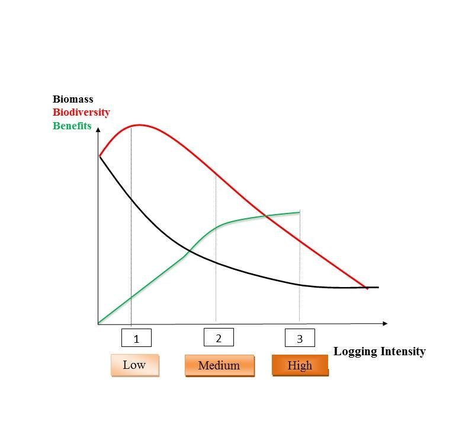

## TmFO in brief

- 30 experimental sites located in 12 countries and three continents (Amazon Basin, Congo basin and West Africa, and South East Asia)

- 657 permanent plots across South America, Africa and South East Asia

- 1276 ha and 6+ million trees measured
       
- Average survey duration: 19 years

- 50+ researchers involved from 25 institutions

## Network structure 

TmFO is coordinated by Cirad and supported by Cirad, the Consultative Group on International Agricultural Research (CGIAR) research program: Forest, Tree and Agroforestry (FTA),  by ESA (European Space Agency) and the French Ministry of Foreign Affairs in support to the Alliance for the conservation of tropical rainforests. These financial supports have allowed the organization of  meetings and  technical workshops, PhD students, participation to international congresses and publications.

## Objectives

Tropical forests represent nearly half of the world's forests and are home for over two thirds of all terrestrial species. However, tropical forests have been disappearing at alarming rates, replaced by cash crops and cattle ranches. Conservation of the remaining tropical forests is undoubtedly one of the main environmental challenges of 21st Century.

Although efforts are needed to preserve undisturbed primary forests through the creation of protected areas, such efforts are not likely to be sufficient to preserve the extraordinary biodiversity and functional services of tropical forests worldwide. Moreover, nearly two thirds of the remaining forests are managed and secondary. The role played by managed forests in the conservation of biodiversity and provision of environmental services (e.g., carbon sequestration, water purification, and provision of non-timber forest products) is becoming more important daily. Nevertheless, managed and secondary forests remain generally perceived as being of low environmental value and are likely to be converted into other land uses. To change this perception and to maintain the remaining tropical forests outside of strict protected areas, efficient and sustainable management practices need to be developed and applied. By “sustainable management" we here refer to evidence-based silvicultural practices that secure forest regeneration and maintain the viability of the forestry sector.

Currently, about 400 million hectares of tropical moist forests are designated as 'production forests', about a quarter of which is managed by rural communities and indigenous people. A challenge for all managers is the gap in current knowledge about the relationship between long-term sustainability of timber harvests and the maintenance of vital functions of these ecosystems. Indeed, it is essential to assess the capacity of tropical forests to regenerate after logging to understand the long-lasting effects of harvests on wood production, biodiversity, and carbon emissions. Such studies, which are currently lacking, are needed for evidence-based silvicultural recommendations to both policy-makers and forest practitioners.

The Tropical managed Forests Observatory (TmFO) aims to assess the impact of selective logging on forest dynamics, carbon storage, and tree species composition in the Amazon Basin, Congo Basin, and South East Asia. To do this, TmFO's researchers are helping each other with the analysis of permanent sample plot data and collaborating on a meta-analysis of their findings. The permanent sample plot network of TmFO so far includes 24 experimental sites, 462 plots representing an area of \>1000 ha and a total of nearly 1000 years of monitoring. The results are expected to provide key insights about forest responses to logging at plot, forest, and regional scales. With this information, TmFO can make informed recommendations that will lead towards more sustainable and profitable tropical forest management.

## Main research questions

TmFO will notably address the following questions:

- How resilient are tropical forests to logging disturbances ?

- What is the conservation value of managed natural forests ?

- Is there a trade-off between economical and environmental sustainability ?

- How does forest responses vary across regions and continents ?

To answer these questions, TmFO will focus on the long-term impact of logging on three main ecosystem services: timber production,carbon sequestration and biodiversity.

## Towards sustainable timber production and environmental services

Tropical forest managements has been most exclusively guided by timber production and logging companies managing large concessions. For more than twenty years, rural populations (i.e. traditional forest communities, farmers) have played a growing role in the forest sector. These new stakeholders have their own perceptions and approaches, geared not only towards timber production, but also towards the use of numerous other resources, such as non-timber forest products (NTFP), or ecotourism. Tropical silviculture needs to adapt to this new context (diversity of players, products and perceptions) and to meet multiple management objectives, such as logging and NTFPs within the same forestry production unit (Guariguata et al. 2011). In addition, the emergence of new payment for environmental services markets opens up economic development possibilities for the environmental services provided by forests. Of these, biodiversity and carbon storage are by far the ones attracting most attention. The silviculture of tomorrow will therefore also have to take into account any compromises between production of goods (timber, NTFP) and the conservation of services (biodiversity, carbon).

{width="500"}
