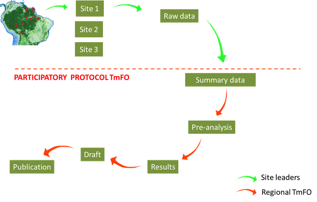

## Data management and policy

TmFO prioritises sustaining research and capacity building in tropical countries. To this end, intellectual property (IP) is seen as a cornerstone, and TmFO strictly preserves the IP of all partner institutions. Data resides exclusively with the site leader(s) responsible for coordinating its collection or analysis. Raw data (i.e. forest inventories) are not shared among TmFO members. Each site leader provides basic summary statistics produced according to a commonly defined protocol (see data flow chart). These data remain the intellectual property of the site leaders and their respective institutions. IP is regulated according to the IP policies of the institution that owns the data.

TmFO is indebted to many scientists, students, field assistants and technicians, who actively contributed to the set-up, data collection and maintenance of the different study sites. We are extremely grateful to them for enabling TmFO to exist and develop.

