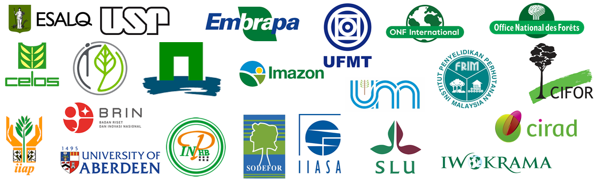

::: {#hero-heading}
**TmFO** — Tropical managed Forests Observatory
:::

TmFO is a network that aims to understand the long-term effects of selective logging on tropical forest ecosystems. It encompasses over 600 permanent forest plots located across the tropics that have been subjected to selective logging and have been continuously monitored since then.

TmFO is an open network, and all scientists, institutions and NGOs interested in the resilience of managed tropical forests are welcome to join.

## TmFO partners

{fig-align="center" width="80%"}
